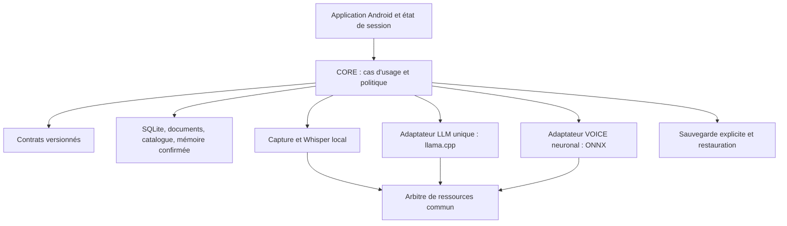

# Architecture proposée — JARVIS-UNIFIED

Statut : spécification préparatoire Mission 001, aucun module développé.
Bases et preuves : [AUDIT.md](AUDIT.md). Migration : [MIGRATION_PLAN.md](MIGRATION_PLAN.md).

## Application et frontières

Une seule application Android installable à terme, avec des modules de bibliothèque
et un graphe de dépendances. Les anciennes applications restent installées tant que
les transferts ne sont pas vérifiés. Aucun lien direct aux activités des trois
projets n'est requis par les contrats.



Dépendances de compilation proposées : `:app` compose `:core`, `:data`, `:documents`,
`:stt-whisper`, `:llm-llama`, `:voice-pocket`, `:backup` ; tous les adaptateurs
implémentent les ports de `:contracts`. CORE dépend des contrats, jamais de JNI,
ONNX, d'une Activity, d'un moteur Android TTS ou d'un futur client distant.
`:resources` partage l'arbitrage et les mesures sans dépendre de l'UI.
L'extraction Gradle viendra après des frontières testables ; pas de big bang.

CORE : commandes/réponses locales, registre d'outils, historique, proposition de
souvenirs, extraction/recherche documentaire, construction du contexte et STT.
Le registre d'outils est proposé ; seuls les comportements présents dans l'audit
sont acquis. Pas de calculatrice, OCR, embeddings ou connecteur réseau annoncés
comme déjà disponibles. LLM génère du texte et compte ses tokens ; VOICE génère
et restitue l'audio avec le profil explicitement sélectionné.

## Flux d'une demande

1. UI crée `requestId` et identifie la session ; aucune tâche lourde au lancement.
2. CORE traite commandes explicites, demandes de confirmation, heure et catalogue.
   Une ambiguïté demande clarification ; une réponse éditoriale n'est pas présentée
   comme preuve documentaire. Un souvenir proposé n'est jamais exécuté comme outil.
3. Si nécessaire, rechercher documents/souvenirs confirmés ; citations structurées.
4. Construire un budget tokenisé avec réserve de sortie ; compacter l'historique
   de session et sélectionner des extraits sans modifier les originaux stockés.
5. Acquérir admission matérielle + bail lourd/résidence LLM, puis générer. Respecter
   la limite actuelle de messages/contexte via l'adaptateur, pas par concaténation
   illimitée du prompt CORE. Une erreur ne devient pas une réponse réussie.
6. Fin native et déchargement confirmés avant VOICE ; transmettre le texte final
   borné à la synthèse neuronale. Pas de génération vocale sur des tokens instables.
7. VOICE obtient ses propres baux/gardes, produit le PCM complet puis le restitue.
   Texte disponible même si voix indisponible ; aucune substitution TTS système.

STT suit de même capture finalisée → Whisper → libération effective → CORE/LLM.
Un seul travail lourd au départ, y compris import, STT et encodage de profil.
La lecture audio légère n'autorise pas implicitement une co-résidence de modèles.
Une optimisation de chevauchement requerra une qualification séparée.

## Contrats CORE ↔ LLM ↔ VOICE v1

Les signatures suivantes sont du pseudo-Kotlin de conception, sans garantie de
compilation et sans code livré. Les DTO n'exposent ni chemin privé arbitraire,
ni handle JNI, ni tenseur vocal à CORE. Les imports passent par le sélecteur local
et des identifiants validés, pas des URI fournies par le modèle.

```kotlin
// Champs communs : protocolVersion=1, requestId, sessionId, deadline monotone locale.
data class ModelRef(val id: String, val sha256: String, val engineId: String)
data class VoiceProfileRef(val id: String, val revision: Int,
                           val packSha256: String, val format: String)
data class Evidence(val sourceId: String, val revision: String,
                    val page: Int?, val chunkId: String, val quote: String)
data class GenerationInput(val requestId: String, val sessionId: String,
                           val messages: List<RoleMessage>, val model: ModelRef,
                           val limits: QualifiedLimits, val evidence: List<Evidence>)
interface LlmPort {
    suspend fun capabilities(): LlmCapabilities
    suspend fun countTokens(input: GenerationInput): TokenBudget
    suspend fun generate(input: GenerationInput): GenerationResult
    fun requestStop(requestId: String) // accuse réception, ne prouve pas la fin
    suspend fun awaitStopped(requestId: String): StopResult
    suspend fun unload(): UnloadResult // confirme destruction native ou erreur
}
data class SpeechInput(val requestId: String, val text: String,
                       val profile: VoiceProfileRef, val settings: QualifiedVoiceSettings)
interface VoicePort {
    suspend fun capabilities(): VoiceCapabilities
    suspend fun synthesize(input: SpeechInput): AudioArtifact
    suspend fun play(requestId: String, artifact: AudioArtifact): PlaybackResult
    fun requestStop(requestId: String)
    suspend fun awaitStopped(requestId: String): StopResult
    suspend fun unload(): UnloadResult
}
interface ProfilePort {
    suspend fun propose(reference: PrivateAudioRef): ProfileProposal
    suspend fun create(proposalId: String, userConfirmation: Confirmation): VoiceProfileRef
    suspend fun list(): List<VoiceProfileSummary>
    suspend fun select(profile: VoiceProfileRef): SelectionResult
    suspend fun delete(profile: VoiceProfileRef, userConfirmation: Confirmation): DeleteResult
}
```

`RoleMessage`, `QualifiedLimits`, `AudioArtifact` et résultats sont des DTO à
spécifier en Mission 003 : bornes, unités, champs requis, absence/null et erreurs
seront figés dans des schémas. `AudioArtifact` référence un objet privé immuable
avec format PCM, fréquence, canaux, nombre de frames, durée, taille et SHA-256 ;
aucun octet audio dans les événements/diagnostics. VOICE choisit sa fréquence
(modèle actuel 24 kHz) ; Whisper reçoit explicitement le WAV 16 kHz mono PCM16.
Ne pas partager les formats par supposition.

Résultats discriminés : succès, refus de sécurité, occupé, modèle/profil absent,
pack incompatible, intégrité invalide, entrée trop grande, délai, annulation,
échec de nettoyage, mémoire insuffisante et échec de restitution. Un succès de
génération n'est pas un succès de lecture ; une lecture complète ne prouve pas
l'audibilité ou la ressemblance. Les capacités rapportent moteur/version, formats,
langues, limites et statut de qualification du matériel/modèle, jamais une
qualification implicite d'un moteur futur.

Événements : `Accepted`, `Loading`, `Generating`, `Generated`, `Playing`,
`StopRequested`, `Stopped`, `Unloaded`, `Refused`, `Failed`, avec requestId,
séquence croissante et horodatage monotone. Un seul résultat terminal par requête.
Les événements périmés ne peuvent pas muter la session courante. Aucun rejeu
automatique d'une écriture, d'une création de profil ou d'un outil après timeout.
Annulation idempotente ; les baux restent acquis jusqu'à la fin native et à la
libération attestée. Une erreur de destruction maintient le blocage sécurisé.

LLM adapte son `LanguageModel` actuel à ce port. VOICE adapte
`ExperimentalSpeechBackend` et le lecteur 005F ; aucun contrat n'affirme une
compatibilité universelle des profils. CORE possède historique et mémoire,
VOICE possède packs/profils/PCM, LLM possède poids/contexte natif. Les citations
restent sous contrôle CORE ; un texte généré ne crée pas une preuve.

## Ressources et profils matériels

| Profil de déploiement | Référence initiale | Règles proposées |
|---|---|---|
| TABLET — Redmi Pad SE | Qwen3 0,6B Q4_K_M | Point de départ TABLETTE ÉCO : contexte 512, sortie 64, un thread ; admission conservée |
| MOBILE — POCO X8 Pro | Qwen3 1,7B Q4_K_M | Candidat, pas qualification ; configuration 003B et repli 0,6B seulement si vérifié et admis |
| CENTRAL — mini-PC futur | À qualifier | Capacités CPU/RAM/OS/backend mesurées avant choix du modèle ; aucune promesse de taille |

Distinguer profil matériel (TABLET/MOBILE/CENTRAL), profil de calcul existant
(ECO/AUTO/BALANCED/TABLET_ECO) et profil vocal. Un nom d'appareil n'autorise
pas le calcul. Les références initiales pourront évoluer ; ajouter un GGUF exige
métadonnées, architecture compatible, SHA-256 fiable, tokenizer/template, licence,
limites et essais. Le moteur reste unique, un modèle actif, aucun second wrapper
LLM importé comme dépendance cachée.

Conserver réserve, budgets et refus LLM de [l'audit](AUDIT.md). Conserver la garde
VOICE actuelle de 2 Gio disponibles et le thread ONNX unique ; elle n'est pas
une enveloppe de résidence démontrée. Le budget global devra intégrer UI, SQLite,
PDF et buffers natifs sans additionner des mesures PSS/RSS qui se recouvrent.
STT et extraction PDF ont aussi besoin de plafonds qualifiés. Refus si budget
inconnu ou ressources insuffisantes ; ne jamais abaisser un seuil pour un test.
Le bail commun n'est ni une réservation de RAM Android ni une protection LMK.

## Politique de mémorisation durable

Distinguer contexte volatil, historique de conversation et souvenirs réutilisables
entre sessions. L'historique éventuel reste visible, configurable et soumis à une
politique de conservation ; il ne devient jamais automatiquement un souvenir.
Aucun résumé de session ou fait inféré n'est promu silencieusement en mémoire.

État d'un souvenir : `Proposed → AwaitingConfirmation → Confirmed → Stored`, ou
`Rejected/Expired/Cancelled`. La proposition contient texte exact, source, date,
portée, durée de conservation et révision. L'UI affiche « Mémoriser durablement ? »
et permet Modifier / Confirmer / Refuser. Confirmation explicite pour chaque ajout,
modification ou import de souvenirs ; un lot n'est possible qu'après présentation
de tous ses éléments et choix explicite. `/remember` ouvre ce même aperçu.
La transcription vocale seule et un « oui » ambigu ne valent pas confirmation.

La confirmation lie proposalId + révision/empreinte du contenu + action + session
à un geste utilisateur non forgeable par la sortie LLM. Texte modifié, proposition
périmée, redémarrage ou session différente : nouvelle confirmation. Une transaction
idempotente écrit le souvenir et la preuve minimale de confirmation ; l'échec ne
laisse pas de demi-écriture. Refus/expiration ne crée aucun souvenir durable.
Les anciens souvenirs importés sont préservés avec provenance `legacy`, inactifs
pour la récupération tant que l'utilisateur ne les a pas confirmés. Aucune
fabrication rétroactive de consentement.

Consultation, correction, oubli et export restent explicites. Suppression retire
le souvenir des index et dérivés actifs ; avertir que les sauvegardes déjà exportées
ne s'effacent pas à distance. Ne pas persister secrets ou propositions refusées
dans les journaux. PDF, catalogue et réponses LLM sont des données non fiables,
sans autorité pour confirmer une mémorisation ou exécuter une action.

## Sauvegarde, restauration et transfert

Proposition, non implémentée : archive portable `jarvis-backup` v1 avec manifeste,
version des schémas, IDs stables, compteurs, provenance des sources, inventaire des
objets et SHA-256 par objet. Export via choix local de l'utilisateur, chiffré et
authentifié avec un format éprouvé et une clé récupérable hors Android Keystore.
Le choix exact du format/KDF exige une mission dédiée ; aucun chiffrement existant
n'est revendiqué. Pas de clé ou de sauvegarde personnelle dans Git ou les logs.

Inclure selon sélection explicite : messages, souvenirs et preuves de consentement,
catalogue et révisions, documents/passages/citations, réglages, références des
modèles et licences, profils vocaux et identité du pack. Originaux PDF/audio
seulement s'ils existent et si l'utilisateur les inclut. Audio de référence et
PCM exclus par défaut ; profils sensibles inclus uniquement sur consentement.
Poids optionnels selon droits et espace ; sinon manifeste de réimport local.
Pas de secrets, clé de signature APK, jetons, cache temporaire ou URI persistante.

Export cohérent : bloquer les mutations, finir/annuler les travaux, utiliser une
sauvegarde SQLite cohérente (ne pas copier une base active seule avec un WAL non
pris en compte), écrire en staging puis valider les comptes/hashes et finaliser.
Conserver la version précédente si disque plein/annulation. Les fichiers à
`noBackupFilesDir` nécessitent cet export applicatif explicite ; le backup système
Android ne suffit pas.

Restauration : déchiffrer/authentifier, contrôler version, tailles, chemins,
doublons et espace, refuser une archive inconnue/corrompue, migrer en zone isolée,
contrôler intégrité/comptes/IDs et relations. Aperçu des conflits et confirmation
avant activation atomique ; rollback conservé. Réimport identique idempotent,
aucun remplacement automatique d'un profil différent. Un profil lié à un autre
pack reste préservé mais non activable. Pas de réencodage vocal silencieux.

L'archive Android→PC transporte des données, pas la preuve que le moteur PC peut
lire tous les formats vocaux. Conserver JVFP1 et son pack ; prévoir un adaptateur
PC compatible ou demander une nouvelle création explicite sans écraser l'ancien.
Les anciens sandbox Android sont inaccessibles directement à UNIFIED : prévoir
un export autorisé depuis l'application source ou une méthode locale supportée.
Le code CORE actuel n'a pas cet export global ; tout ajout dans une source exige
une mission séparée explicitement autorisée. Ne jamais désinstaller pour extraire
les données ; la compatibilité de signature doit être vérifiée avant mise à jour.

## Futur mode hybride, entièrement optionnel

D'abord import/export par fichier local ou USB, sans permission réseau dans la
variante Android locale. Futur adaptateur CENTRAL dans une variante séparée,
activation utilisateur, appairage authentifié, chiffrement de transport, droits
par opération et minimisation des données. Pas de découverte/connexion automatique,
cloud, synchronisation cachée ou exposition du serveur loopback existant au LAN.

Négociation version/capacités/modèles/profils, requêtes corrélées et erreurs
compatibles avec les ports. Une deadline monotone ne traverse pas les machines :
transmettre un délai restant borné, appliqué localement par chaque côté.
Déconnexion ≠ calcul arrêté ; garder le suivi distant et refuser un repli local
concurrent tant que l'arrêt distant n'est pas confirmé. Les écritures durables
restent sous confirmation Android et ne sont pas rejouées automatiquement.
Aucun adaptateur réseau n'est développé dans cette mission.

## Compatibilité et décisions restant à qualifier

CORE minSdk24/SDK35, LLM minSdk29/SDK36, VOICE expérimental minSdk26/SDK35 ; AGP et
Kotlin diffèrent. Proposition de départ pour une build intégrée : ABI ARM64,
SDK36 et JDK21 de LLM, cible minSdk29 à examiner. Ce n'est pas une hausse de SDK
appliquée : confirmer les OS réels et le maintien éventuel d'API24–28 avant de
figer la matrice. Pas de suppression silencieuse de compatibilité.

Identité applicative/signature stable, format de sauvegarde, politique d'historique,
plafonds PDF/audio et qualification des deux appareils seront des décisions
explicites des prochaines missions. Le module local conserve absence d'INTERNET,
backup système désactivé, données privées et aucune dépendance cloud obligatoire.
