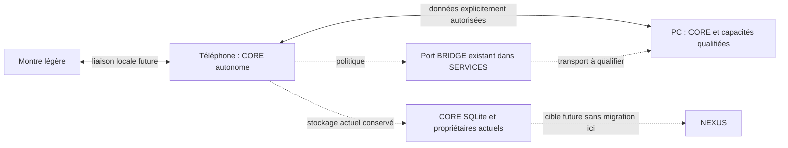

# Architecture SYNC V1 — proposition documentaire

**Version de conception1, non implémentée ; aucun transport ou schéma adopté.**
Lire d’abord les [conflits ADR et responsabilités](RESPONSABILITES_ET_ADR.md).
SYNC est une capacité future des modules existants, pas une application/service
central supplémentaire. Catalogue et expressions : [EXPRESSIONS V1](EXPRESSIONS_V1.md).

## Topologie et autonomie

Téléphone : conserve modèles déjà installés, stockage et fonctions locales même
PC éteint, liaison refusée ou versions incompatibles ; aucun appel cloud ni compte
obligatoire. Le passage à l’inférence PC est optionnel, distinct de SYNC, soumis
à session/autorisation et ressources ; jamais deux générations lancées pour la
même requête à l’insu de l’utilisateur. Aucune promesse de failover natif en vol.

PC : pair de réplication, non serveur obligatoire ni autorité des sessions du
téléphone. Chaque CORE reste autorité locale ; un choix utilisateur exporté ne
vaut pas ordre d’exécution sur l’autre appareil. Pas de réplication de sessions,
workers, baux RAM, états natifs ou permissions d’outils actives.

Montre : projection minimale via téléphone (texte bref, tâches sélectionnées,
événements frais et interactions), pas de GGUF, encodeur ou profil vocal personnel
par défaut. Si téléphone absent : état déconnecté visible, horloge/consultation du
minimum déjà autorisé si plateforme compatible ; commandes sensibles non exécutées
ni mises en attente comme ordres rejouables. Brouillons locaux explicitement
marqués peuvent revenir au téléphone pour validation, sans pouvoir de confirmation
implicite. Stockage chiffré/accès écran verrouillé à qualifier selon la montre.
Ni Wear OS, Bluetooth, Wi-Fi Direct ni SDK constructeur présumés disponibles.

## Périmètre de données : défaut = ne pas partager

| Type | Règle et unité de transfert | Exclusions et conflits |
|---|---|---|
| Souvenir confirmé | Contenu exact/version/provenance et preuve de confirmation, appareil(s) et finalité explicitement autorisés | Nouvelle formulation ou fusion exige nouvelle confirmation ; aucun historique brut, prompt, diagnostic ou souvenir legacy sans preuve |
| Préférence portable | Clé allowlist, type/version et valeur ; consentement de partage | Aucun secret, chemin privé, budget RAM/thermique, droit système ou clé de signature ; édition simultanée même clé = choix utilisateur |
| Tâche | Données déclaratives et statut confirmé, pas commande exécutable | Fin vs annulation, modification de date ou contenu concurrents = conflit ; import ne lance ni outil ni workflow |
| Document sélectionné | Métadonnées autorisées et contenu immuable par blocs ; droits/licence/provenance conservés | Pas de répertoire entier implicite ; chemins SAF locaux non transportables ; index FTS régénérables, pas de copie SQLite/FTS brute |
| État utile | Événement borné avec origine, portée, version, fraîcheur et durée de validité | État expiré présenté périmé ; « terminé » ne vaut pas preuve de tâche effectuée ; pas d’état natif/de verrou/autorisation active |
| Catalogue éditorial | Hors flux personnel par défaut ; pack de données révisé, opt-in séparé | Réutiliser CatalogueJson ; ce n’est pas une mise à jour logicielle ni un second catalogue |

Profils/références vocales, PCM cachés, poids GGUF/ONNX, clés, jetons et identifiants
sensibles de comptes sont exclus de SYNC V1. Une future procédure VOICE privée
est distincte, avec compatibilité moteur/pack et consentement propre. Les fichiers
chiffrés de backup ne sont pas automatiquement importés comme données synchronisées.

## Consentement et sécurité locale

Proposition : appairage de proximité avec confirmation sur deux écrans déverrouillés,
identités de clés dédiées, preuve de possession et authentification mutuelle issue
d’une bibliothèque reconnue ; canal local chiffré et anti-rejeu obligatoire.
TLS1.3 mutuel ou mécanisme sécurisé adapté au lien montre sont **options à évaluer**,
non décision de transport/crypto. Pas de certificat auto-accepté, de découverte
LAN assimilée à l’identité ou de repli non chiffré. Clés privées par appareil dans
stockage protégé de plateforme si disponible ; jamais Git, catalogue ou backup
portable non explicitement conçu pour les secrets.

CORE autorise catégories, objets, sens de transfert, pairs, durées et contexte de
verrouillage ; VOICE reste autorité technique sur l’usage de ses profils, sans
pouvoir confirmer une mémoire. Confirmation du souvenir et consentement à partager
sont deux actes distincts. Le reçu lie contenu exact/révision/digest local, acte,
acteur local, finalité, destinataires et version de politique. Le pair ne s’octroie
pas des droits en déclarant authorization_ref ou source=CORE.

Le CORE récepteur vérifie identité, preuve recevable et autorisation locale avant
toute écriture personnelle durable ; consentement récepteur explicite ou règle
de partage préalablement confirmée couvrant précisément ce contenu et ce pair.
Sans couverture : refuser le contenu, annoncer seulement un élément en attente ;
aperçu volontaire temporaire après accord, aucun « inbox » durable secret implicite.
Résolution de conflit produisant un nouveau souvenir = aperçu exact et confirmation.

Inventaires et noms de documents restent confidentiels : ne montrer à un pair que
les objets autorisés. Pas de hash de texte privé dans une annonce publique ; IDs
aléatoires et digests sous canal authentifié, cache/logs locaux minimisés ; proposer
HMAC pour les identifiants de comparaison sensibles, clés/domaine à définir. SHA256
assure l’intégrité d’un bloc, pas son authenticité ; manifeste lié au canal et à
l’identité autorisée. Pas de clé ou algorithme maison.

Révocation : invalider sessions de partage, grants et clés de session, réviser
l’epoch du groupe ; supprimer/rendre inaccessibles les copies gérées selon demande
et politique approuvée, tracer ACK quand le pair revient. Pair absent ou compromis :
révocation locale immédiate, **effacement distant non garanti**. On ne retire pas
une information déjà lue/copieuse à un appareil hostile. Toute ancienne archive
reste sous politique de restauration et de non-résurrection.

## Réplication logique et différentielle

Ne pas synchroniser les fichiers SQLite actifs, journaux WAL, préférences brutes
ou fichiers DataStore. Chaque propriétaire expose un adaptateur transactionnel
après autorisation ; CORE arbitre, BRIDGE transporte sans accès universel aux bases.

Un objet a collection/type, ID stable aléatoire, schéma, révision logique, digest,
provenance et métadonnées de consentement séparées du contenu. Identifiant local
existant conservé par mapping versionné : aucune réécriture d’ID en mission design.
Les IDs catalogue sont textuels bornés, les IDs personnels ont leur namespace.

Proposition de causalité : événement unique (pair, compteur monotone persistant),
ensemble de parents et version vectorielle **bornée aux pairs appairés**. Horloge
murale = information UI, jamais arbitre du gagnant. Même digest avec ID événement
identique = no-op ; même ID avec digest différent = CORRUPT/EQUIVOCATION, aucune
écriture. Compteur réinitialisé/restauration ancienne = nouvel epoch d’appareil,
réconciliation contrôlée, jamais écrasement silencieux. Révision entière locale
existante du catalogue n’est pas une horloge multi-maître.

Écart existant : SERVICES Memory.delete/purgeExpired supprime physiquement des
entrées et export() ne restitue que les souvenirs non expirés ; il ne fournit pas
de journal de tombstones ou de consentements distribués. Ne pas traiter un export
vide comme une suppression synchronisée. Les révisions du catalogue LLM ne sont
pas davantage un journal causal de groupe. Une évolution réversible et testée des
adaptateurs propriétaires est nécessaire avant toute réplication.

Journal local/outbox transactionnel au commit du propriétaire et curseur durable
**par pair, collection et epoch de consentement**. Changements non autorisés non
révélés ; changement de périmètre = nouveau snapshot filtré, pas ancien curseur
réutilisé pour supprimer des données locales. Ne jamais déduire une suppression
d’un objet absent d’un manifeste filtré ou interrompu.

Protocole : négocier capacités/versions → inventaire filtré et watermark figé →
plan du delta confirmé → envoyer opérations/métadonnées puis blocs manquants →
vérifier identité/grants/intégrité/causalité → staging → commit transactionnel →
ACK durable. ACK transport ≠ commit métier ; curseur n’avance qu’après ACK métier.
Objet document important : staging sur même stockage, vérification taille/digest,
puis bascule atomique du manifeste de référence ; journal de récupération si
transaction DB+fichier impossible. Originaux/version précédente conservés selon
rétention approuvée ; aucun overwrite de l’original utilisateur.

Pour un gros document, blocs fixes négociés (proposition256Kio), hashes ordonnés,
longueur totale et identifiant de contenu. Renvoyer seulement les blocs manquants
validés ; pas de promesse de delta binaire optimal après décalage du texte. Quota
de staging et taille totale réservés avant transfert, vérification de chaque bloc
et du fichier final. Déduplication seulement dans le même domaine autorisé, pas
preuve qu’un contenu privé existe sur un autre domaine.

## Conflits, suppression et reprise

| Cas | Décision sûre proposée |
|---|---|
| A descend causalement de B | Appliquer A si consentement et version supportés ; conserver la révision précédente conformément à rétention |
| Deux modifications concurrentes | Conserver branches de versions ; conflit visible, aucune règle « dernier timestamp gagne » |
| Champs distincts de préférences | Fusion par clé seulement si indépendance explicitement définie ; sinon conflit |
| Même souvenir, contenus divergents | Aucun collage/LLM automatique ; nouveau contenu et confirmation exacte à demander |
| Suppression vs édition concurrente | Suppression logique bloque utilisation/projection et résurrection automatique ; garder conflit privé à résoudre selon politique de rétention, pas effacement historique prétendu |
| Document édité des deux côtés | Deux versions, sélection explicite ; aucun merge de binaire automatique |
| Tâche terminée/annulée concurrente | Statut conflictuel, aucune action relancée ni rappel annulé implicitement |
| Doublon ou ACK perdu | Déduplication par opération persistée ; resend même opération = no-op ; réponses compatibles seulement |
| Fin de connexion/cancel/arrêt brutal | Staging privé borné, opérations engagées retrouvées par journal ; demande état d’opération avant reprise |
| Stockage plein/corruption | Refus avant commit, originaux conservés, reçu incomplet explicite ; journal non acquitté |

Tombstone = suppression logique révisée, non purge physique. Répliquer seulement
l’effacement explicitement autorisé, sans diffuser le contenu supprimé. Ne pas
purger une tombstone sur simple TTL : attendre ACK de tous les pairs actifs ayant
pu connaître l’objet. Pair exclu puis revenant : nouveau bootstrap avec epoch et
watermark anti-résurrection ; son ancien snapshot ne réintroduit rien. Un pair
perdu doit être explicitement retiré pour permettre compactage. La rétention
personnelle et la purge physique sont à définir, y compris backups : ne promettre
ni conservation éternelle ni effacement physique global automatique.

États de session : disconnected → negotiating → planning → transferring → verifying
→ applying → committed ; paused/recoverable, cancelled, incompatible, denied ou
corrupt sont distincts. Annuler n’annule pas un commit déjà durable ; répondre
COMMITTED si son ACK a été perdu. Une révocation avant commit impose revérification
du grant ; publication d’un commit et prise en compte de la révocation sont
sérialisées localement, impossibilité de garantie instantanée entre pairs offline.

## Compatibilité, ressources et séparation des mises à jour

Versions : protocole, collection, normaliseur/index et format document négociés
séparément. Version majeure inconnue ou champ critique inconnu : refuser sans
modification ; extension optionnelle ignorée seulement si contrat négocié le dit.
Jamais downgrade destructif/effacement sur absence de migration. Snapshot incomplet
n’efface rien. Les migrations physiques restent distinctes et sauvegardées.

Lecture/reprise par petits lots ; pas de tâche lourde ni PC réveillé pour un simple
ACK. Budgets/chiffrement/hash/IO mesurés sur téléphone/montre, limites proposées
non garanties, backpressure et annulation ; contraintes premier plan, restrictions
Android et réseau à qualifier. Pas de permission INTERNET ajoutée aux applis
LLM/VOICE dans ce design, ni daemon sans fin. Les manifests actuels ne prouvent pas
un transport réel ; un futur transport SERVICES exige autorisation dédiée.

Canal de données séparé des mises à jour : ne transporte ni APK, script, patch,
code, modèle ou permission exécutable. Un document reçu n’est jamais évalué. Les
catalogues éditoriaux sont des données revues ; installation logicielle, signature,
rollback et EVOLUTION ont procédures et autorisations distinctes.

## Scénarios de qualification futurs

T1 PC absent ; T2 téléphone absent/montre verrouillée ; T3 mauvais pair et consentement
manquant ; T4 changements concurrents + horloges fausses ; T5 delete vs edit puis
retour d’un pair ancien ; T6 bloc coupé, digest faux et quota plein ; T7 crash avant
commit, après commit avant ACK puis reprise ; T8 version future/inventaire filtré ;
T9 révocation avant commit/pair offline ; T10 ancien backup avec nouveau device epoch ;
T11 autorisation rétrécie et zéro fuite de métadonnées ; T12 import tâche sans exécution ;
T13 téléphone sans PC/cloud, budgets conservés. **Tests non exécutés : pas de runtime
SYNC développé.** Contrats proposés dans [CONTRATS](CONTRATS_INTEGRATION_PROPOSES.md).
