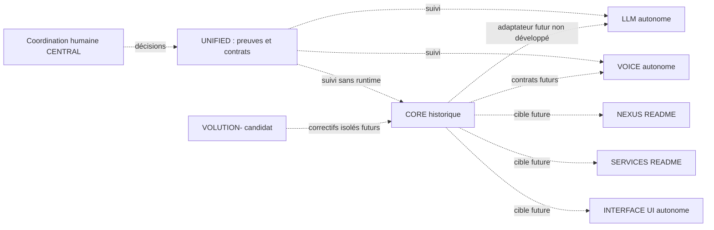

# Matrice de fusion et d’intégration — Phase B

Données machine : [integrations.json](../registry/integrations.json). Portée :
refs inspectées de repositories.json ; absent signifie absent dans ces sources,
pas preuve universelle sur une branche privée/inaccessible.

| Relation runtime | Contrat | Code de liaison | Test intégration | Appareil | Dans main | Preuve et prochaine action |
|---|---|---|---|---|---|---|
| CORE↔LLM | Défini/versionné, proposé v1 | Absent | Non exécuté | Non exécuté | Non | AppGraph→LlamaLocalEngine, LLM sans service ; adaptateur autorisé séparément |
| CORE↔VOICE | Défini/versionné, proposé ; DTO local005I présent | Absent | Non exécuté | Non exécuté | Non | CoreVoiceRequestV1 ne reçoit aucun appel IPC CORE ; qualifier puis mapper |
| CORE↔NEXUS | Enveloppes v1, opération documentaire à détailler | Absent | Non exécuté | Non exécuté | Non | NEXUS README seul ; documents actuellement dans CORE |
| CORE↔SERVICES | Enveloppes v1, outils spécifiques à détailler | Absent | Non exécuté | Non exécuté | Non | SERVICES README seul ; permissions à concevoir |
| CORE↔INTERFACE | Enveloppes v1, événements UI à détailler | Absent | Non exécuté | Non exécuté | Inconnu | INTERFACE autonome, pas de main annoncée ; AvatarSession sans rendu |
| EVOLUTION↔modules | Enveloppes v1, correctifs spécifiques à détailler | Absent | Non exécuté | Non exécuté | Non | VOLUTION- README ; rôle encore à confirmer |
| UNIFIED↔tous | Contrats de suivi/versionnement v1 | Aucun runtime prévu | Non exécuté runtime | Non exécuté | Non pour nouveaux livrables | Registres/audits présents localement ; aucune dépendance d’application |

Les tests de schéma ici ne changent aucune case « test d’intégration runtime ».
Les bibliothèques VOICE appelées par005I sont un chemin **intradépôt** confirmé
par source (expression/identity/pocket). Elles ne prouvent pas un lien CORE↔VOICE.
Les fonctions PDF/RAG/SQLite/Whisper/LLM/TTS actuelles de CORE sont également des
liens internes à conserver, pas une migration dans les nouveaux dépôts.

Quatre verdicts indépendants :
1. Même projet ChatGPT : contexte humain, état technique non démontré.
2. Même compte GitHub : neuf identités accessibles, aucune liaison implicite.
3. Merge Git : CORE corrections incluses ; LLM/VOICE hors main ; INTERFACE main
   inconnue ; UNIFIED livrables locaux hors main. Voir le graph daté de l’inventaire.
4. Runtime : aucune liaison inter-APK démontrée dans les sources sélectionnées ;
   aucune qualification sur appareil pendant cette mission.

