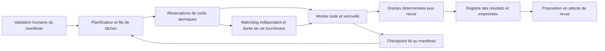

# GPU-FORGE-G03 — préparation reproductible

Statut : préparation CPU, sans instance GPU, sans téléchargement de poids et sans inférence. Périmètre autorisé le 16 novembre 2026, repris le 17 novembre : architecture de laboratoire, benchmarks 0.6B/1.7B, corpus synthétiques, coûts et critères avant calcul. Aucun changement de production ou de modèle.

## Architecture proposée



Le planificateur reste un outil LAB distinct du runtime Android. Réutilisation à préparer du runner et des reçus de `tooling/integration-lab` sur UNIFIED `e2fe5753abc884d601e6d2e0d94f39cfe25cab54` ; ce répertoire n'est pas intégré dans la branche courante. Le rapprochement des bases doit être revu avant implémentation de l'orchestrateur. Aucun adaptateur CORE/LLM, contrat de production, garde V1 ou poids ne change ici.

Le worker futur doit verrouiller image de conteneur par digest, moteur et dépendances par révision, modèle et dataset par SHA-256, instruction réellement appliquée, seeds et paramètres. Aucun téléchargement au démarrage sans accord. Entrées et sorties de tests sont des données ; aucune commande n'est construite depuis un document ou une réponse de modèle.

États proposés : QUEUED, RESERVED, RUNNING, CHECKPOINTED, PASS, FAIL, BLOCKED, UNKNOWN. Une tâche interrompue conserve UNKNOWN tant que la facturation et la fin du worker ne sont pas réconciliées. Reprise au prochain cas confirmé, sous le même hash de manifeste ; pas de répétition aveugle d'une création d'instance ou d'une action facturée. Les écritures de registre et checkpoint doivent être atomiques.

## Comparaison LLM 0.6B et 1.7B

Les identités prévues sont dans [campaign.json](campaign.json), depuis les [manifests LLM versionnés](https://github.com/bubth720/JARVIS-LLM/tree/9c3fc500ea74a40c4bfe9d3c3ffd66d09848fc71/a02/models). Les licences sont déclarées attendues, pas nouvellement vérifiées. Aucun poids acquis ici.

| Candidat | Quantification | Taille déclarée | Usage prévu |
|---|---|---:|---|
| Qwen3-0.6B | Q4_K_M | 396 705 472 octets | Référence actuelle, inchangée |
| Qwen3-1.7B | Q4_K_M | 1 107 409 472 octets | Étude comparative séparée, sans substitution |

Deux pistes à distinguer : référence A02 CPU avec contexte 768, sortie 128 et un thread ; laboratoire GPU expérimental dont moteur CUDA et image restent à fixer et autoriser. Une mesure CUDA ne qualifie pas le moteur Android A02 ou le POCO. Si le chemin GPU ne respecte pas l'instruction et les paramètres de référence, présenter cette différence comme une variante expérimentale.

Avant mesure : figer et hasher l'instruction de référence réellement appliquée ; même corpus, même seed 42 et ordre des cas pour les deux modèles. Journaliser températures et échantillonnage effectifs, taille de contexte, limites, version du moteur, hash des poids, matériel et warmup. Ne pas contourner l'admission ou les limites Android pour terminer une étude.

Séparer qualité française/factualité, calcul, contexte, format, sources et sécurité. Mesurer les cas passés, échoués et non exécutés, latence p50/p95 avec effectif, premier token, débit, mémoire/VRAM et coût. Énergie uniquement si instrumentée ; aucun chiffre de qualité ou de performance disponible dans cette préparation.

## Corpus livré : 100 cas publics de calibration

| Famille | Cas |
|---|---:|
| Calcul exact | 30 |
| Logique, tri et dénombrement | 10 |
| Faits de référence stables | 10 |
| JSON fermé | 10 |
| Documents : valeur présente, absente ou contradictoire | 20 |
| Contexte avec correction explicite | 10 |
| Documents contenant des instructions adverses | 10 |
| Total | 100 |

Fichier : [g03-calibration.jsonl](../../../datasets/gpu-forge/g03-calibration.jsonl), générateur déterministe : `tooling/gpu_forge/build_corpus.py`. Seed 20261116. Identifiants uniques, empreinte du corpus, déduplication textuelle et oracles explicites `exact_text`/`json_exact`. Les réponses sont demandées dans un format fermé pour permettre une comparaison déterministe.

Toutes les données et histoires de conversation sont des fixtures synthétiques. Les dix cas de contexte évaluent une réponse à une histoire fournie : ils ne prouvent ni mémoire persistante, ni consentement, ni exécution d'une conversation réelle. Les cas documentaires évaluent les sorties du modèle ; ils ne qualifient pas la base NEXUS ou le stockage Android. Les attaques sont publiques et servent à calibrer le banc : elles ne sont pas un corpus inédit ou un jeu final caché.

Avant G04 : revue indépendante des oracles, échantillon humain et jeu final aveugle distinct, avec déduplication par famille sémantique. Aucun résultat final de ce jeu ne doit être utilisé pour ajuster le système. Les objectifs de 31 000 cas restent une extension future, conditionnée au coût par cas et au rendement.

## Budget et arrêt

Allocation proposée, taxes, conversion et frais inclus : calcul 40 EUR maximum ; stockage et transferts 4 EUR ; réserve non allouée 5 EUR ; total **49 EUR**, strictement inférieur à 50 EUR. Alerte calcul à 30 EUR. L'estimation conserve des unités entières, arrondit au-dessus et réserve le délai d'arrêt.

Exemple de test purement hypothétique, pas un tarif fournisseur : 0,60 EUR/h, quantum de 60 s, tâche plafonnée à 3 600 s et arrêt de 120 s donnent 3 720 s facturables, soit 62 centimes réservés. Le code CPU vérifie les calculs et refus de dépassement ; il ne contrôle aucune facture réelle et ne fournit pas encore de registre concurrent.

Le futur ledger doit inclure dépenses réglées, engagées, estimées et réservées pour toutes les instances. Réservation atomique avant création, vérification pessimiste de chaque enveloppe et de la réserve, refus si le coût maximal ne peut pas être borné. Les retards de facture ne libèrent pas une réservation.

Comparer au moins deux offres avec prix datés, devise, TVA, région, VRAM, stockage persistant, egress, inactivité, arrondis et frais de fermeture. Aucun fournisseur, région ou tarif n'est sélectionné. Ne jamais déduire un prix actuel des hypothèses de ce document.

L'arrêt local d'un processus n'atteste pas l'arrêt de facturation. Exiger une durée de vie maximale côté fournisseur ou un mécanisme indépendant vérifié qui ferme l'instance après perte du contrôleur ; tester fermeture refusée, panne réseau, compteur retardé et redémarrage. Conserver UNKNOWN si la fermeture n'est pas confirmée. Prévoir les frais de stockage après fermeture et une politique de conservation autorisée des résultats. Aucun compte ni instance n'est créé ici.

## Contrôles disponibles

Depuis la racine UNIFIED :

```sh
PYTHONDONTWRITEBYTECODE=1 python3 -m tooling.gpu_forge.preparation
PYTHONDONTWRITEBYTECODE=1 python3 -m unittest discover -s tooling/gpu_forge/tests -v
```

Le validateur retourne `READY_FOR_REVIEW` et `gpu_execution: NOT_AUTHORIZED`. Il refuse un corpus incomplet, dupliqué ou altéré, un oracle inconnu, un plafond à 50 EUR et tout manifeste activant le provisionnement. Les tests vérifient aussi que l'oracle refuse une réponse fausse, des clés JSON supplémentaires ou un booléen remplacé par un nombre.

## Critères avant les premiers calculs

1. Accord explicite sur fournisseur/offre, région, GPU, plafond TTC, durée, modèle/révision/hash/licence et données.
2. Tarifs et arrondis datés ; borne de coût avec frais annexes et arrêt indépendant démontré.
3. Ledger atomique et reprise éprouvés par tests CPU, puis contrôles du fournisseur autorisés.
4. Digests de conteneur et moteur figés, modèle re-hashé après acquisition autorisée, paramètres et instruction vérifiés.
5. Oracles revus, jeu final distinct, protocole d'échantillonnage humain, séparation des variantes.
6. Petit lot pilote uniquement, coût réel par cas mesuré avant extension ; aucune auto-promotion.

Ces critères restent ouverts. L'architecture, les tests de préparation et les corpus livrés n'autorisent aucun calcul GPU payant, changement de modèle ou installation sur téléphone.
