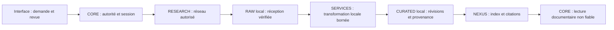

# N01-A2 — orientations validées, portée d’exécution

17 novembre 2026. Autorité : validation explicite de l’utilisateur dans la mission N01-A2.

1. Interface V4 **Nexus modulaire pour Android**, évolutive vers mini-PC.
2. **RESEARCH possède exclusivement les accès réseau aux sources autorisées. NEXUS reste local.**
3. Contrats existants conservés ; adaptations futures versionnées et testées.
4. Fiches documentaires NEXUS, souvenirs personnels CORE et personnalité Athéna sont trois domaines distincts.
5. RAW/CURATED local, provenance et transformations traçables, quotas et suppression contrôlée.

Cette validation remplace l’incertitude architecturale de N01-A sur la séparation réseau. Elle ne lance pas de collecte, migration, entraînement, instance GPU ou installation. Les contrats wire concrets, l’IPC Android, l’authentification interprocessus et une éventuelle évolution des protections restent des décisions distinctes.

Correction explicite du document N01-A : son schéma « worker SERVICES isolé : accès autorisés » ne doit pas être implémenté comme un second accès réseau. **Les parseurs et outils SERVICES ne reçoivent que des objets locaux autorisés.** Un worker de transport appartient au composant RESEARCH, même si des bibliothèques de contrôle pures sont réutilisées. UNIFIED n’héberge aucun runtime.

Flux retenu :

Une URI présente dans un document n’ouvre aucun droit réseau. Un résultat documentaire ne crée ni souvenir personnel ni changement de personnalité. Les futurs liens de l’interface restent « non raccordés » tant qu’un événement et un port réels ne les attestent pas.

Les données d’audit et de tests sont synthétiques ou du code public de développement. GitHub sert ici aux sources et à la CI, jamais au fonctionnement documentaire hors ligne.
