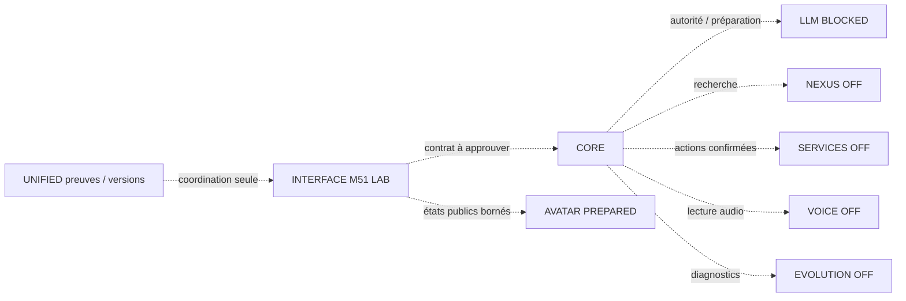

# Références et graphe de compatibilité M51

Les huit modules runtime cibles sont CORE, LLM, INTERFACE, NEXUS, SERVICES, VOICE, AVATAR et EVOLUTION ; UNIFIED est une neuvième entrée de coordination, sans runtime ni moteur. AVATAR partage uniquement la référence source INTERFACE et son contrat minimal ; ce n'est pas un dépôt/renderer autonome déjà qualifié.

| Module | Référence sélectionnée (complète dans BASELINE-LOCK) | Versions observées | État d'assemblage M51 |
|---|---|---|---|
| CORE | PR27, 5da98383ed12cb5a54e896fbe57560bacc432fb5 | AGP8.7.3, Kotlin2.0.21, min24/target35, JVM17, arm64 | Hors hôte M51 reçu ; mandat LLM absent |
| LLM | PR15, 69400fe26d61688262b94cc8a2d5efe20d1da4be | Gradle8.11.1, AGP8.10.1, Kotlin2.1.21, SDK36/min29, NDK28.1.13356709, CMake3.22.1, llama.cpp1b70350c92563449576bcbbf552994b1d1ed847d | BLOCKED ; patch d'autorité non appliqué |
| INTERFACE | PR16, 0dfeef8ff09d60a68d18398ccb6b2530f3b87df4 | Gradle8.13, AGP8.9.2, Kotlin2.1.20, ComposeBOM2025.04.01, SDK35/min26, JVM17 | Source UI-01C à composer par hôte distinct |
| NEXUS | PR12, be70faa41d202d77eb8cf0cc5c831e10cfb020b5 | Gradle8.10.2, Kotlin2.0.21/AGP8.7.3, JDK17/bytecode1.8, Android optionnel min24 | OFF dans ce cockpit ; gateway/FTS5 séparés |
| SERVICES | PR12, 8d80d09d6aabf6eac00a7bc6bb4930862bd72812 | Gradle8.13, AGP8.9.2, Java11, min26/SDK35 | OFF, écritures non autorisées |
| VOICE | PR20, fe57452fcb33f5b6870070f30ba6c5f1d349c4ba | Gradle8.13, Kotlin2.1.20/AGP8.9.2, JVM17, ONNX1.27.0, min26 | OFF ; mémoire combinée/audio Android inconnus |
| AVATAR | Même référence INTERFACE | AvatarSession : setVisible/resize/release seulement | PREPARED ; aucun master approuvé reçu |
| EVOLUTION | PR6, 84ebc2e2b55d48306247fc9045a712294abaf457 | Gradle8.13, Kotlin2.1.20, modules JVM | Diagnostics/propositions séparés ; exécution OFF |
| UNIFIED | PR20, a73c1571f3e1dd0acd50e87b9742fbe2214a93d2 | Python3.12/std lib pour cette livraison | Coordination hors ligne seulement |

Les versions ne sont **pas harmonisées arbitrairement**. UI-01C peut être assemblée seule avec son outillage. Ajouter CORE/NEXUS/LLM demande un graphe d'artefacts/bytecodes et une composition Gradle qualifiés ; monter tous les plugins Android/Kotlin dans un même root sans étude n'est pas accepté. Le minSdk potentiel du LLM29 ne remplace pas celui du cockpit26 ni le support historique CORE24. Une compilation ARM64 ne prouve pas un démarrage Android.

Toutes les flèches sont **cibles documentaires**, pas des communications démontrées dans la nouvelle APK. M50-S1B avait qualifié un vrai SessionCoordinator avec une réponse synthétique sous un autre commit ; cette preuve ne se transfère ni au LLM réel ni à UI-01C/M51.

## Sources, branches et licences

Le verrou contient pour chaque dépôt SHA/tree sélectionnés, branche, default_branch et SHA/tree par défaut, PR, CI à ce SHA et empreintes des fichiers inspectés. INTERFACE n'a pas de branche main observée ; son défaut est development/mission-002. VOICE utilise par défaut feat/pocket-tts-cpu-prototype, distincte de son main b80b1728c481200b3b0e11c0843f1a268a184fa1. Une PR ouverte n'est pas un merge autorisé. Le graphe d'ascendance complet des branches distantes non clonées reste NOT_RUN ; aucun simple SHA différent ne prouve à lui seul une absence de cherry-pick.

53 fichiers publics de configuration/port sont récupérés aux références immuables et leur Git blob SHA-1 recalcule exactement l'entrée de tree ; SHA256 et taille sont conservés. Le contrat Avatar apparaît une seconde fois sous son module propre (54 documents de module, 53 blobs distincts). La lecture des arbres n'acquiert aucun poids, audio ou profil. Un git fsck/build complet de chaque dépôt n'est pas revendiqué : les clones/bancs respectifs et leurs CI sont des couches de preuve distinctes.

GitHub renvoie license=null sur les huit dépôts : licence de dépôt **UNKNOWN**, pas absence juridique prouvée. Les notices Qwen Apache-2.0 et ONNX/NETAI MIT présentes dans certains dépôts sont identifiées et hashées séparément ; elles ne re-licencient pas automatiquement tout le code, les modèles ou les assets. Aucun poids/référence privée n'est redistribué. Les inconnues JDK réellement utilisé, version de wrapper absente CORE, certains targetSdk et NDK sont null/UNKNOWN plutôt qu'inventés à partir de jvmTarget.
